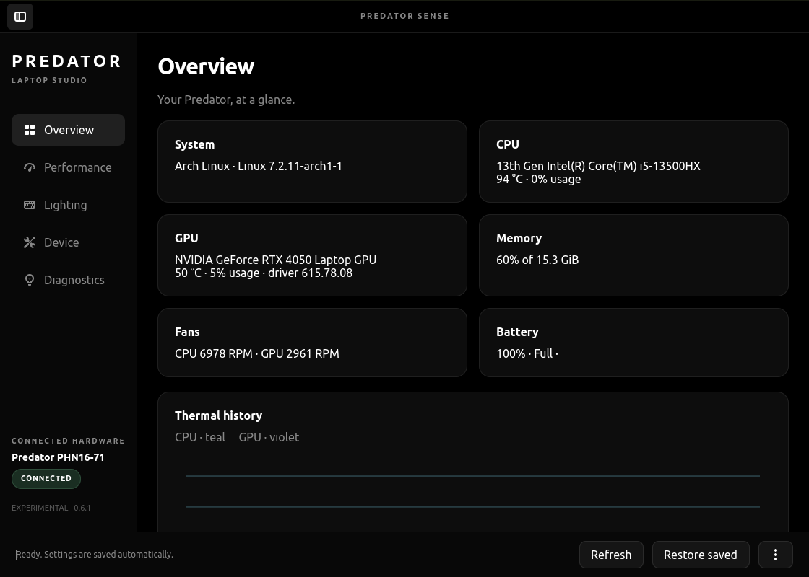
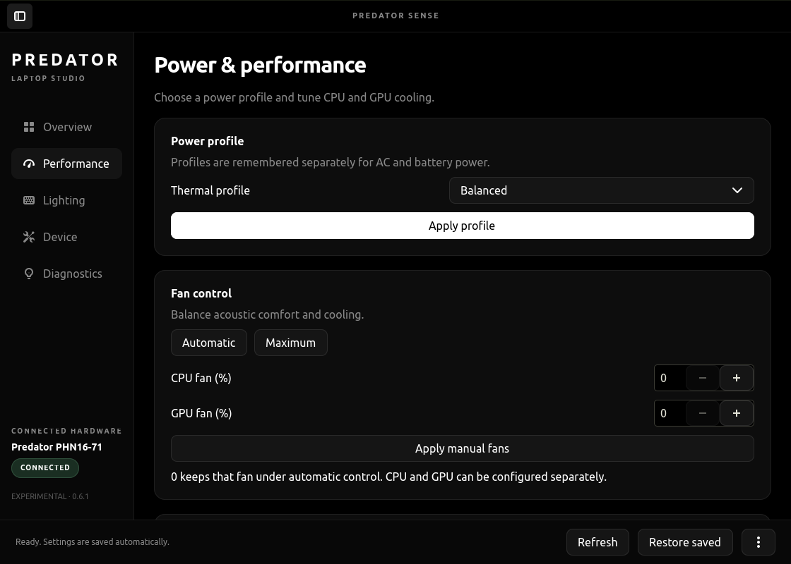
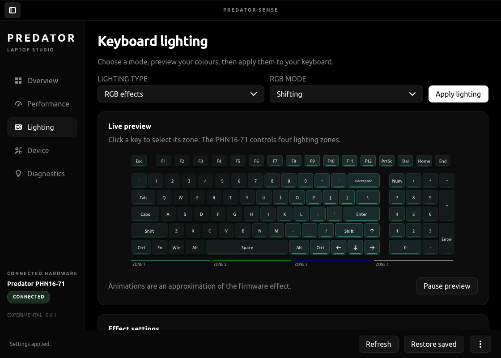
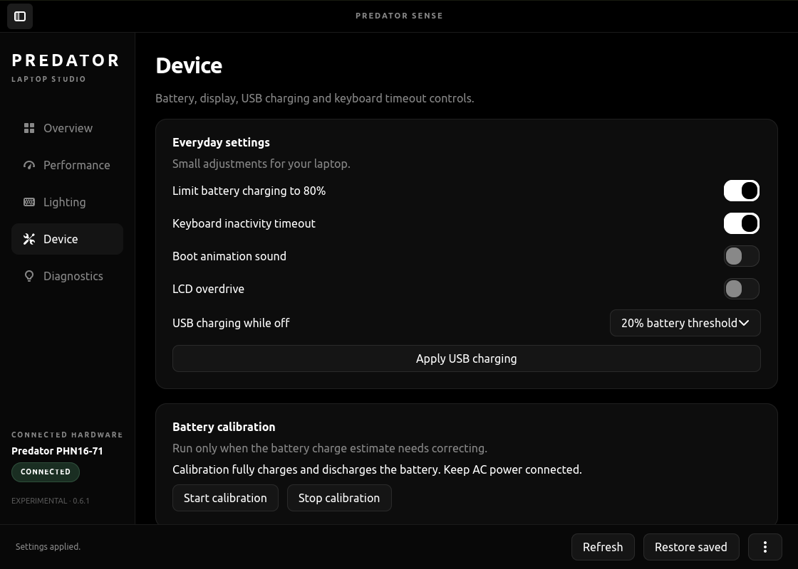

# Predator Sense

A native Rust kernel driver, daemon, and GTK4 control studio for the **Acer Predator Helios Neo 16 (`PHN16-71`)** by Nirusaki.

Stripped down to specialize exclusively on the PHN16-71 hardware platform. Eliminates legacy multi-generation quirks, dead abstraction layers, and runtime overhead—yielding an ultra-responsive, rock-solid stack with a resident memory footprint of just **~60 MB** (compared to **~1 GB** for the official Windows PredatorSense app and **~200 MB** for the legacy Avalonia/.NET C# port).

## Screenshots

<p align="center">
  
  
</p>
<p align="center">
  
  
</p>

## Supported Hardware

• **Acer Predator Helios Neo 16 (`PHN16-71`)**: Exclusively supported. Hardware identification (`sys_vendor: Acer`, `product_name: Predator PHN16-71`) is strictly verified before initialization. All generic quirks, force-model hacks, and legacy EC/i8042 paths were stripped out to deliver maximum execution speed, zero bloat, and ironclad system stability.

## Install on Linux

Open a terminal and paste this without `sudo`:

```sh
curl -fsSL https://raw.githubusercontent.com/Nirusaki-Malaal/PredatorSense/main/bootstrap.sh | sh
```

The universal source installer checks host hardware compatibility, downloads the source tree, builds the Rust workspace, and provisions the signed DKMS v3 kernel module along with the daemon, tray indicator, and GTK4 studio. Sudo is requested only when installing system services and kernel components.

Pass options directly to the bootstrap script:
```sh
# Automatically resolve and install package dependencies (apt, pacman, dnf, zypper)
curl -fsSL https://raw.githubusercontent.com/Nirusaki-Malaal/PredatorSense/main/bootstrap.sh | sh -s -- --install-deps

# Userspace-only install (skips DKMS build if running over an existing driver)
curl -fsSL https://raw.githubusercontent.com/Nirusaki-Malaal/PredatorSense/main/bootstrap.sh | sh -s -- --userspace-only
```

For manual build steps and post-install management, see [Documentation.md](Documentation.md#installation--deployment).

## Features

• **Physical Performance Mode Button**: Fully functional via kernel netlink uevent dispatch—cycling modes (Quiet, Balanced, Performance, Turbo) instantly without dropped input events.  
• **Dynamic Fan Curves & Turbo Mode**: Custom and automatic fan curves remain fully active during Turbo mode; fan speeds scale intelligently according to temperature instead of being locked to a harsh 100% duty cycle.  
• **4-Zone RGB Keyboard Lighting**: Real-time animated canvas preview synchronized to the compositor frame clock, custom zone color pickers, 8 hardware lighting effects, speed/brightness controls, and persistent settings.  
• **Background System Tray**: Lightweight `ksni` status indicator (`predator-tray`) for instant profile switching, fan telemetry monitoring, and background operation.  
• **Hardware Controls**: Battery health charge limiter (80%), USB power-off charging toggle, LCD overdrive toggle, and BIOS boot sound control.  
• **Lean Memory Footprint**: **~60 MB total RSS** across all components (Daemon ~1.1 MB, Tray ~8 MB, GTK4 UI ~50 MB), running rings around the ~1 GB Windows bloatware and ~200 MB garbage-collected C# Avalonia ports.

## Fixed Bugs & Improvements

| Area | Previous Driver / Linuwu-Sense / Windows | PredatorSense Remake |
| :--- | :--- | :--- |
| **Performance Button** | Physical button events frequently missed or dropped by input subsystem | Dedicated kernel netlink uevent dispatcher (`predator-events`) guarantees 100% catch rate |
| **RGB Persistence** | RGB lighting settings reset or forgotten across reboot and suspend | Atomic JSON state storage with isolated ACPI readback verification |
| **Turbo Mode Fans** | Forced fans to a screaming 100% clamp, ignoring thermal curves | Uncapped Turbo power targets while preserving dynamic custom fan curves |
| **System Tray** | Missing or unstable tray icon under modern Wayland/X11 compositors | Dedicated, asynchronous `ksni` StatusNotifierItem background tray |
| **Memory Footprint** | ~1 GB (Windows PredatorSense) / ~200 MB (Avalonia/.NET port) | **~60 MB RSS total** with zero garbage collection overhead |
| **Kernel Module** | Deprecated DKMS build syntax, manual modprobe workarounds | Modernized DKMS v3 build with automated native MOK key generation and signing |
| **Hardware Scope** | Bloated multi-model compatibility matrix with fragile runtime overrides | Clean, single-target specialization strictly for Acer Predator PHN16-71 |

## AI usage disclosure

Reverse engineering, protocol validation, and Rust modernization were developed with AI assistance using advanced agentic models. Hardware boundaries, WMI buffers, and ACPI execution paths have been rigorously audited and test-verified against live hardware. See [Documentation.md](Documentation.md#architecture--safety-audit).

## License

GPL-3.0-or-later. Copyright (C) 2026 Nirusaki. Predator Sense is independent of Acer Inc. Read [Documentation.md](Documentation.md) for full architecture specifications, protocol formats, and hardware internals.
